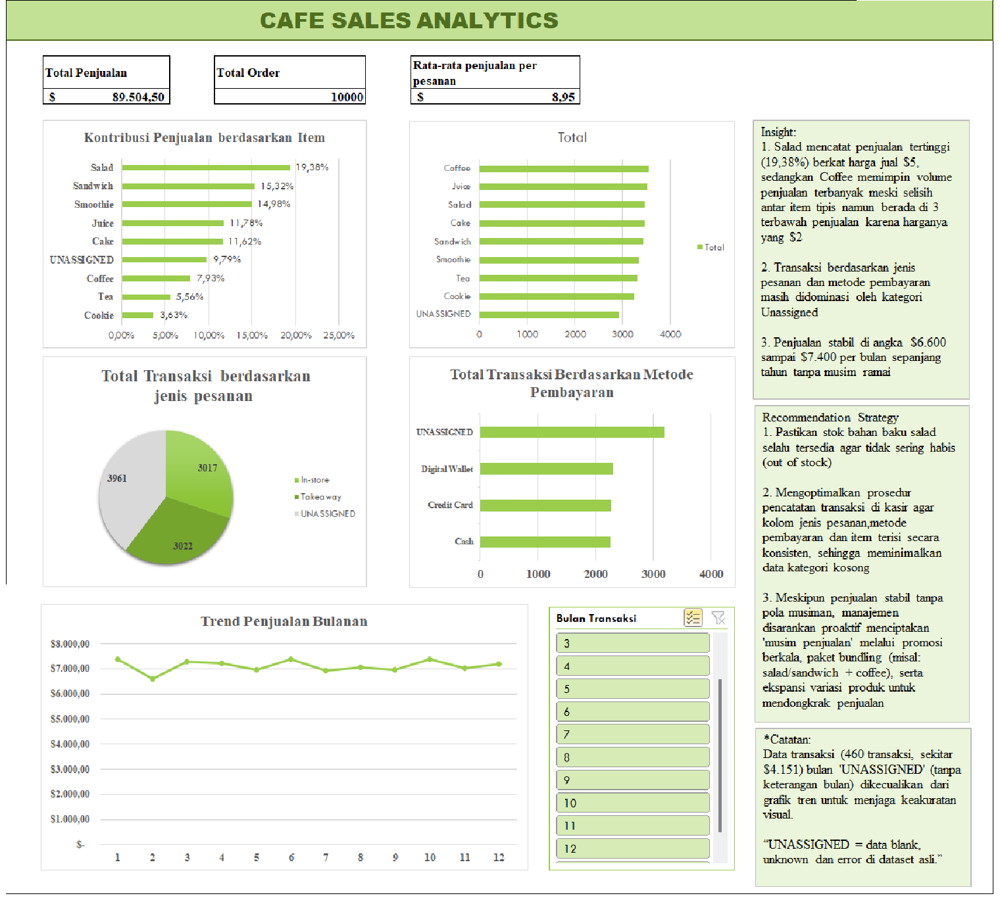

# Cafe Sales Analytics: Dashboard Penjualan Kafe di Excel

Dashboard Excel interaktif untuk menganalisis 10.000 transaksi penjualan kafe tahun 2023.

> [Unduh cafe_sales_dashboard.xlsx](cafe_sales_dashboard.xlsx) dan buka di Microsoft Excel agar slicer dapat digunakan.

## Tujuan
Mengubah data transaksi yang kotor menjadi dashboard yang membantu melihat item
terlaris, pola transaksi, dan tren penjualan bulanan.

## Sumber Data
Dataset penjualan kafe dari Kaggle:
https://www.kaggle.com/datasets/ahmedmohamed2003/cafe-sales-dirty-data-for-cleaning-training

Dataset ini adalah data latihan dengan banyak nilai kosong, tidak diketahui, dan error.

## Isi File Excel
File `cafe_sales_dashboard.xlsx` terdiri dari tiga sheet:
1. **Dashboard:** kartu ringkasan, grafik, slicer bulan, serta insight dan rekomendasi.
2. **Data Bersih:** data transaksi setelah pembersihan.
3. **Pivot Table:** ringkasan yang menjadi sumber grafik di Dashboard.

## Langkah Pembersihan Data
1. Menyeragamkan nilai kosong, tidak diketahui, dan error menjadi "UNASSIGNED".
2. Memisahkan ID transaksi menjadi nomor transaksi.
3. Membuat tabel harga acuan per item, lalu mengisi harga per unit yang kosong
   dengan XLOOKUP. Harga Tea disesuaikan menjadi 1,5 dengan IF sesuai dataset asli.
4. Mengisi sisa nilai kosong pada harga per unit dan kuantitas dengan mean imputation
   (kuantitas dibulatkan ke bilangan bulat).
5. Menghitung ulang total belanja: kuantitas × harga per unit.
6. Membuat kolom bulan transaksi dengan IF dan MONTH; tanggal yang kosong
   diberi label "UNASSIGNED".

## Isi Dashboard
- Total penjualan ($89.504,50), total order (10.000), dan rata-rata penjualan per pesanan ($8,95)
- Kontribusi penjualan dan total unit terjual per item
- Total transaksi per jenis pesanan dan metode pembayaran
- Tren penjualan bulanan

Slicer bulan memfilter kartu ringkasan dan grafik per item, jenis pesanan, dan metode
pembayaran. Grafik tren sengaja menampilkan data setahun penuh.

## Insight Utama
- Salad memberi kontribusi penjualan tertinggi (19,38%) karena harganya yang lebih tinggi,
  sedangkan Coffee memimpin dari sisi jumlah unit terjual.
- Penjualan bulanan relatif stabil, sekitar $6.600 sampai $7.400, tanpa pola musiman yang jelas.
- Banyak transaksi berkategori "UNASSIGNED" pada jenis pesanan dan metode pembayaran.

## Rekomendasi
- Menjaga ketersediaan bahan baku item terlaris agar tidak kehabisan stok.
- Menyeragamkan pengisian data jenis pesanan dan metode pembayaran di kasir.
- Mendorong penjualan lewat promosi berkala dan paket bundling, karena penjualan
  cenderung stabil sepanjang tahun.

## Keterbatasan
- Kategori "UNASSIGNED" cukup banyak, sehingga memengaruhi analisis per jenis pesanan
  dan metode pembayaran.
- Pada baris dengan item tidak diketahui, harga per unit diisi dengan rata-rata,
  sehingga total pada baris tersebut merupakan estimasi.
- Mean imputation sederhana dan bisa menyamarkan variasi data asli.
- Sebanyak 460 transaksi tidak memiliki tanggal, sehingga dikecualikan dari grafik tren
  bulanan.
- Dataset bersifat latihan, bukan data bisnis nyata.

## Tools
Microsoft Excel: Pivot Table, Pivot Chart, slicer, XLOOKUP, IF, GETPIVOTDATA.
